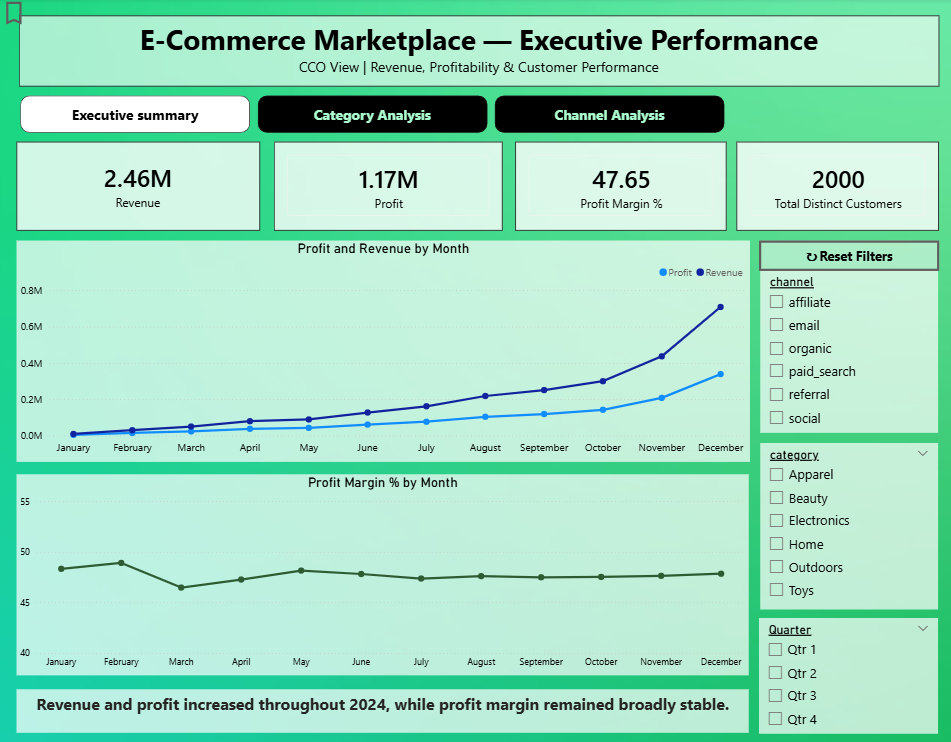
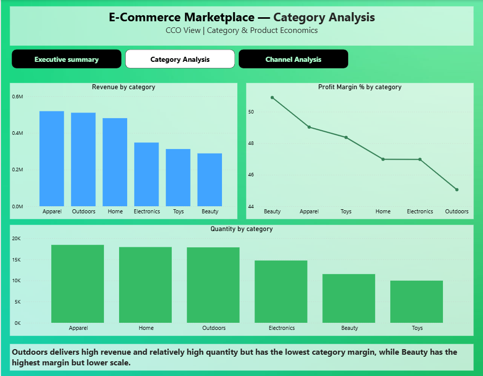
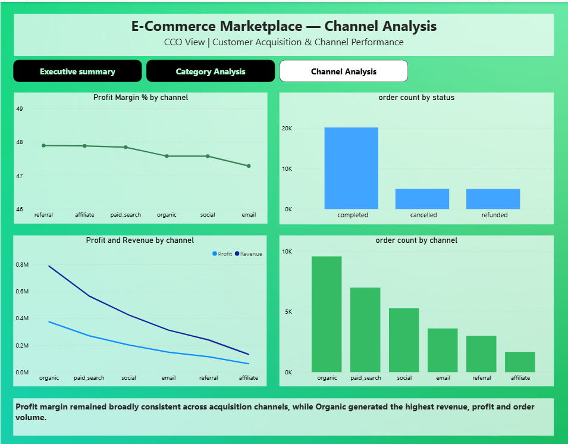

# E-Commerce Marketplace — Commercial Performance Analysis

A business analytics project using **Excel, Power BI, and DAX** to evaluate revenue, profitability, product performance, and acquisition-channel trends for a synthetic e-commerce marketplace.

The objective was to understand whether revenue growth translated into profitable growth and identify areas requiring further commercial investigation.

## Business Questions

- Are revenue and profit growing together?
- Which product categories have higher or lower profit margins?
- Which products combine high sales volume with relatively lower margins?
- How do acquisition channels compare in revenue, profit, and order volume?

## Dataset

The project uses a synthetic dataset containing five related tables and approximately **104,000 records**.

| Table | Records |
|---|---:|
| Customers | 2,000 |
| Orders | 12,000 |
| Order Items | 30,120 |
| Products | 120 |
| Events | 59,599 |

## Tools & Techniques

- **Excel:** Data preparation and validation
- **Power BI:** Data modelling, interactive dashboards, and visualization
- **DAX:** KPI calculations and analytical measures
- **Business Analysis:** Performance analysis, KPI interpretation, and recommendations

## Key Findings

- **Revenue and profit:** Both increased through 2024, while profit margin remained broadly stable.
- **Category performance:** Outdoors generated high revenue but had the lowest category-level profit margin; Beauty had the highest margin at a lower scale.
- **Product performance:** High-scale, lower-margin products were identified for further commercial review.
- **Acquisition channels:** Organic generated the highest revenue, profit, and order volume, while channel margins remained broadly comparable.

## Dashboard Preview

### Executive Summary

### Category Analysis

### Channel Analysis

## Project Files

- [**Read the PDF Case Study**](E-Commerce-Marketplace-Case-Study.pdf) — Detailed methodology, dashboard analysis, findings, recommendations, and limitations.
- [**Open the Power BI Report**](E-Commerce-Marketplace-Performace-Analysis.pbix.pbix) — Interactive dashboard file.

## Limitations

- Marketing spend is unavailable, so customer acquisition cost (CAC) and lifetime value (LTV) cannot be calculated.
- Profit represents product-level contribution based on product cost; shipping, fulfilment, and marketing costs are excluded.
- The analysis identifies performance differences but does not establish their underlying causes.

**Built by Kritika Sharma**  
Indore, India | [LinkedIn](https://www.linkedin.com/in/kritika-sharma-a72199235/)
